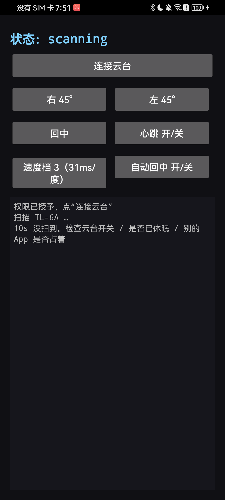

# MoisPano720 / TL-6A 蓝牙云台 · 控制协议（逆向）

> 一句话：这台贴牌全景云台的官方 App 早就停止维护、加固锁死，但控制命令并不复杂——**17 字节的一帧 BLE 数据，先发唤醒帧、等 600 ms、再发执行帧**，就能让它精确转任意角度。
>
> 本仓库只包含「让云台转」所需的最小东西：协议、可直接跑的 Python CLI、最小 Android 实现。**不含任何 AI / 相机 / 语音功能**，那些留给你自己搭。

  

---

## 这是什么设备

| 项 | 值 |
|---|---|
| 市场名称 | MoisPano720（贴牌，同一硬件还有别的名字） |
| BLE 广播名 | `TL-6A_201810000000`（后缀像是序列号，你的机器可能不同） |
| BLE MAC | `FC:58:FA:B1:23:C2`（**因机而异**，请按名字扫描，不要硬编码 MAC） |
| 已知 Service | `00001910-0000-1000-8000-00805f9b34fb` |
| 写特征 | `0000fff1-0000-1000-8000-00805f9b34fb`（`WRITE_NO_RESPONSE`，不需回执） |
| 读特征 | `0000fff4-0000-1000-8000-00805f9b34fb`（本仓库用不到） |
| 轴 | 只有一个水平旋转轴（pan / 偏航），没有俯仰 |
| 限位 | 无绝对编码器，软件按「累计角度」回中；单帧最大 360° |

---

## 三条用法，选一条

### 1. 电脑上直接试（最快，Python）

```bash
pip install bleak
python python/gimbal.py scan                 # 找设备
python python/gimbal.py turn 90              # 右转 90°
python python/gimbal.py turn -45             # 左转 45°
python python/gimbal.py turn 90 --speed 1    # 用最慢档
python python/gimbal.py home                 # 按累计角度回中
python python/gimbal.py hold                 # 心跳保活（Ctrl+C 停）
```

Windows / macOS / Linux 都能用（bleak 走系统蓝牙栈）。第一次连之前别让别的 App 占着它。

### 2. 安卓里用（最小库）

`android/` 是一个**已编译通过、已装进真机跑起来**的最小示例：`GimbalBle.java` 只有连接、转向、回中、心跳、自动回中这几件事，`MainActivity` 是六个按钮（无 res 资源、无第三方依赖）。

```java
GimbalBle g = new GimbalBle(context, new GimbalBle.Listener() {
    @Override public void onLog(String msg) { Log.i("gimbal", msg); }
    @Override public void onState(String state) { /* idle/scanning/connecting/ready/lost */ }
});
g.connect();                     // 按广播名前缀 TL-6A 扫描并连接
g.setMode(3);                    // 速度档 1..4（3 最快）
g.turn(90);                      // 正=右，负=左
g.turn(-45, 1);                  // 左转 45°，用 1 档
g.home();                        // 按累计角度反向补偿回中
g.startHeartbeat();              // 20s 一帧零偏移，防休眠
g.setAutoHome(true, 10000);      // 转完 10s 无新动作自动回中
```

构建（无需 Android Studio）：

```bash
# JDK 17 + Android SDK（compileSdk 34）；AGP 8.7.2，Gradle 8.13 亲测通过
cd android
gradle :app:assembleDebug          # 产物 app/build/outputs/apk/debug/app-debug.apk
```

跑起来的界面（真机截图，`docs/ui.png` 是权限弹窗那一步）：



> 协议本身（帧格式 / 600ms 时序 / 四档速度）与作者另一台机器人项目里长期在用的实现完全一致；本仓库的 Android 代码是它的精简移植，帧构造已用单元自测核对（`+90°` → `04 00`、`360°` → `10 00`）。

### 3. 任意语言照协议写

协议只有一页，见 **[PROTOCOL.md](PROTOCOL.md)**。核心就三行：

```text
帧 = 11 01 55 01 02 08 | VH VL | 方向 | 档位 | 88 88 88 88 | 00 0D 0A
V  = round(|角度| / 360 * 4096)        # 0.088°/step
方向 = 1(右) / 0(左)    档位 = 1..4
动作 = 发唤醒帧(deg=0) → 等 600ms → 发执行帧(角度)
```

---

## 四档速度（实测，不是估算）

| 档位 | 实测 ms/度 | 180° 实测耗时 |
|---|---|---|
| `mode 1` | 105 | 19.0 s |
| `mode 2` | 164 | 29.5 s |
| `mode 3` | **31（最快）** | 5.5 s |
| `mode 4` | 80 | 14.3 s |

> 档位和速度**不是单调排列的**：3 最快、1 次之、4 再次、2 最慢。台厂固件就是这么写的，别"顺手排个序"。

动作耗时 ≈ `600ms（唤醒）+ |角度| × ms每度`。

---

## 必须知道的三件事

1. **只发一帧，它不动。** 这是从零逆出协议时最大的坑：`11 01 55 ...` 单帧发出去毫无反应。真机试出来的正确时序是「先发一帧 `deg=0` 的唤醒帧，停 600 ms，再发带角度的执行帧」。
2. **它自己会睡。** 静置几分钟后 BLE 广播都消失，此时发什么都没用。要长期在线就每 20 s 发一帧 `deg=0`（不动、纯维持唤醒）。已经睡死的只能手动拨一下云台开关。
3. **没有绝对角度。** 它不回报当前朝向，`home` 是"按我记住的累计角度反向补回去"，不是读传感器。所以：手动掰过、断电重启过，累计量就失真了，需要重新以"当前朝向"为 0 点。

---

## 协议怎么来的（如果你也想逆一个）

完整过程见 [PROTOCOL.md](PROTOCOL.md)，简短版：

1. 手机开发者选项开 **HCI snoop log**，用官方 App 正常转一次，抓 `btsnoop_hci.log`；
2. 抓包里能看到一条写特征，负载固定 17 字节、前 6 字节恒定，中间两字节随角度变化；
3. 官方 App 是 **360 加固**（`libjiagu.so` 四件套），但加固只护 dex——`lib/` 里的 `.so` 是明文；
4. `llvm-readelf --dyn-syms libcorenew.so` 直接能看到 `Java_com_dermandar_dmd_1lib_VRkitRotatorManager_sendCommand`，未 strip；
5. 反汇编对出帧骨架 → 真机试出「唤醒帧 + 600 ms + 执行帧」→ 掐表标定四档速度。

---

## 目录

```
.
├─ README.md                  ← 你在这
├─ PROTOCOL.md                ← 协议全文（帧表、时序、逆向过程、踩过的坑）
├─ AI_GUIDE.md                ← 给 AI 看的浓缩版：告诉它仓库地址，它照这个就能写
├─ python/gimbal.py           ← 命令行工具（scan / turn / home / hold / raw）
├─ android/                   ← 最小安卓工程（GimbalBle + 六按钮界面，可编译）
└─ docs/
   ├─ frame-reverse-notes.md  ← 逆向过程的技术细节与失败尝试
   ├─ btsnoop-notes.md        ← 抓包怎么读、怎么对上
   └─ ui.png                  ← 真机运行截图
└─ LICENSE (MIT)
```

## 验证到哪一步了

| 项 | 状态 |
|---|---|
| 帧构造正确性 | 自测通过（`+90°→04 00`、`+360°→10 00`、`-45°→DIR=00`） |
| Python CLI | 本机实测：`scan` 能列出周边 BLE 设备、`status` 正常；设备不在场时给超时提示 |
| Android 工程 | `gradle :app:assembleDebug` 编译通过（AGP 8.7.2 / Gradle 8.13 / compileSdk 34）；APK 已装进真机，权限申请、扫描、10s 超时提示均正常 |
| 转向 / 四档速度 | 取自作者长期真机使用的同一实现，`ms/度` 为实测值 |

> 建仓时手上这台云台处于关机/休眠状态（BLE 扫不到），因此转向没有在本仓库代码上逐条复测；协议与实现同源，帧构造已逐条核对。第一次跑时按 `docs/frame-reverse-notes.md` 第 5 节用秒表复核四档即可。

## 给你的 AI 用

把仓库地址丢给 AI，再补一句"按 `AI_GUIDE.md` 实现"，它就能直接产出可运行的控制代码——那份文件把设备特征、帧格式、时序、速度表、常见错误都写成了它一眼能用的形式。

## 兼容性 / 免责

同款贴牌硬件（MoisPano720、TL-6A 系列）大概率通用；**不同固件的档位速度可能有差异**，请以 `ms/度` 实测校准。本仓库与任何厂商无关，协议为互操作性目的从公开可得的设备行为中归纳，自担风险使用。
